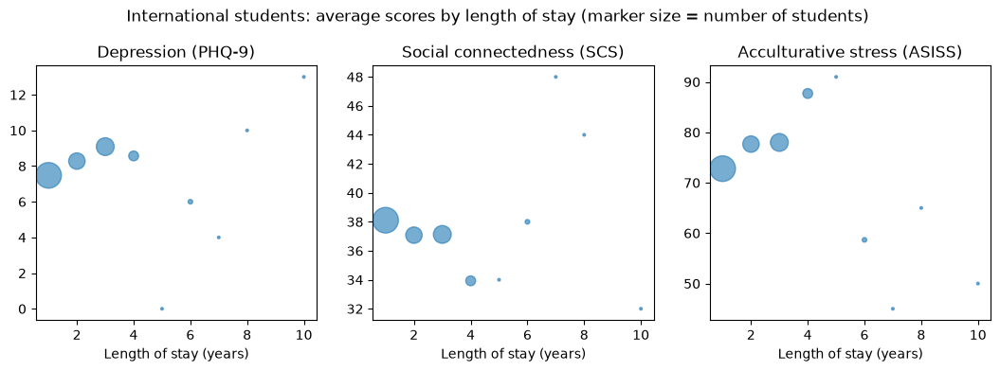

# International students' mental health (SQL)

SQL analysis of a 2018 survey at a Japanese international university, looking at depression, social connectedness and acculturative stress among international and domestic students. Queries run on DuckDB directly against the CSV.



## Data

`students.csv`: 268 survey responses. The data comes from the DataCamp project of the same name.

## Key results

- International students do not report more depressive symptoms than domestic students in this sample, but they do report much higher acculturative stress (75.6 against 62.8).
- Among international students, depression is related to lower social connectedness (r = -0.54) and higher acculturative stress (r = 0.41).
- Length of stay on its own is almost unrelated to depression (r = 0.07).

## Running the notebook

```bash
pip install -r requirements.txt
jupyter notebook notebook.ipynb
```
